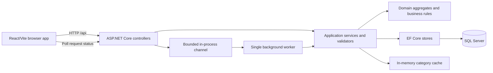

# Architecture and design

## System view

The API solution separates HTTP controllers, application services/contracts, domain objects, and EF Core infrastructure. React owns presentation and local form state. The API is the authority for validation and persistence. EF Core migrations define the schema and seed manufacturers, categories, and sample vehicles.

## Data and categorisation

- `Vehicle` stores owner, manufacturer reference, year, VIN, registration number, and `decimal(18,2)` weight in kilograms.
- `Manufacturer` is a seeded table, rather than a repeated string in each vehicle row. The UI currently keeps its manufacturer choices in code; [OUTSTANDING.md](OUTSTANDING.md) tracks that mismatch.
- `VehicleCategory` stores name, optional description, lower and optional upper weight bounds, and an icon key. The icon catalog is currently the four keys `bike`, `car`, `van`, and `truck`.
- A vehicle does **not** store a category ID. The browser resolves its current category from the latest loaded category ranges and its weight. This avoids stale persisted assignments when ranges change, but the list must reload categories after a completed change.

Ranges are **lower inclusive, upper exclusive**: `[minWeightKg, maxWeightKg)`. The first range starts at zero, consecutive ranges meet exactly, and only the final range has a null upper bound. Thus `499.99` is Light, `500.00` is Medium, `2499.99` is Medium, and `2500.00` is Heavy. Vehicle weights must be positive, so the zero lower bound is a coverage sentinel rather than a valid vehicle weight.

The category command replaces the **complete** category set. The validator rejects gaps, overlaps, duplicate names, invalid bounds, and a missing open-ended final category. The store saves the replacement in one database transaction and the service invalidates the in-process category cache. There is no automatic adjustment of neighbouring ranges; invalid proposals are rejected.

## Write processing and consistency

Vehicle create/update and category replacement return `202 Accepted` with a queue ID. A bounded channel holds up to 100 pending items; one worker executes them in fresh dependency-injection scopes. Clients can poll `GET /api/request/{id}` for `queued`, `running`, `succeeded`, or `failed`. Reading a terminal status removes it. A successful `202` means accepted for processing, not committed to SQL Server. Queue contents and statuses disappear on process restart; failed jobs expose a state but no user-facing failure detail.

This design keeps the local deployment simple, but it has no durable queue, retries, cross-process coordination, or distributed cache invalidation. It should run as one API process on one machine. SQL Server remains the durable store for completed writes. The browser currently waits for status in its request helper; category and vehicle screens still have workflow and refresh gaps listed in [OUTSTANDING.md](OUTSTANDING.md).

## Other decisions

- Search and paging execute in SQL Server. The API supports filtered, ordered pages of 10; the UI currently sorts only the loaded page.
- Input validation runs in ASP.NET Core model binding and application/domain rules. EF Core parameterizes normal queries; sort expressions use a fixed allowlist. Expected errors use Problem Details, while unhandled worker failures are logged.
- Responses include `X-Correlation-ID`. `/health` checks web-host availability only. Swagger/OpenAPI is enabled in Development.
- There is no authentication or authorization requirement for this local assessment. Any deployment beyond trusted local use needs a security design.
